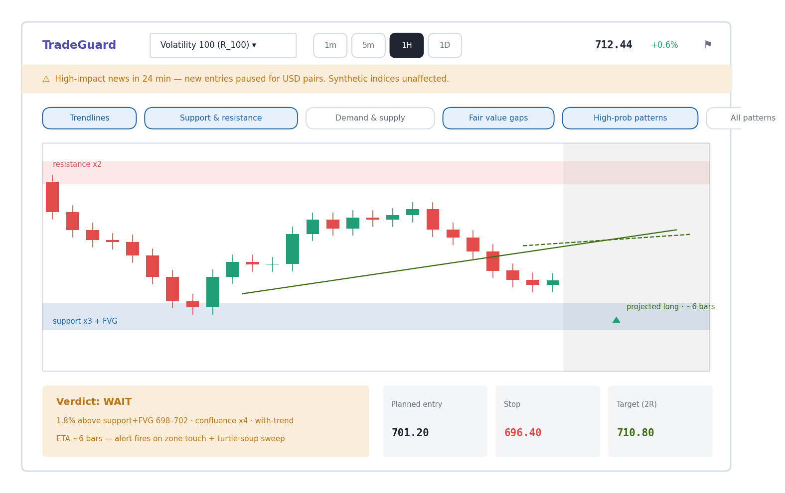

# TradeGuard

TradeGuard is a paper-only trading analysis dashboard. It scans market candles,
explains support/resistance, supply and demand, fair-value gaps, moving
averages, candlestick and chart patterns, and returns a deterministic
**WAIT / ENTER / STAND ASIDE** verdict. It never places broker orders or holds
funds.



> **Prototype and education tool:** market data can be delayed or unavailable,
> and no output is financial advice. Paper trades are simulated in local
> SQLite only.

## Quick start

### Requirements

- Python 3.11 or newer
- Node.js 20 or newer
- macOS/Linux, WSL, or Git Bash on Windows

Clone the repository and enter it:

```bash
git clone git@github.com:Ex057/tradeguard.git
cd tradeguard
cp .env.example .env
```

Install dependencies and create the local database:

```bash
./start.sh setup
```

Start the backend and web client:

```bash
./start.sh start
```

Open <http://localhost:5173>. The FastAPI documentation is at
<http://127.0.0.1:8000/docs>.

## Data sources

Set `DATA_SOURCE` in `.env`:

| Mode | Behavior | Credentials |
|---|---|---|
| `fixture` | Offline deterministic candles for demos and tests | None |
| `yahoo` | Latest-available Yahoo candles/quotes for real markets | None |
| `deriv` | Free public Deriv WebSocket ticks and candle streams; includes all current Volatility indices | None for public market data |

Yahoo is a fallback/display source, not a broker-executable quote. Synthetic
indices such as Volatility and Crash have no Yahoo equivalent and fail clearly
when Deriv is unavailable. In Deriv mode, the app maintains one connection for
the selected pair and streams ticks independently from the timeframe candles.

For local development, start with `DATA_SOURCE=fixture`. To use real markets,
set `DATA_SOURCE=yahoo`. To use synthetic indices, set `DATA_SOURCE=deriv`:

```dotenv
DATA_SOURCE=deriv
```

The default connection is Deriv's unauthenticated public endpoint,
`wss://api.derivws.com/trading/v1/options/ws/public`. The pair selector includes
V10, V25, V50, V75, V100 and every currently active 1-second Volatility variant.

Never commit `.env` or API keys.

### Candle history

Deriv requests 600 bars by default and retains up to 2,000 streamed bars in
memory. Adjust `CANDLE_HISTORY_BARS` and `CANDLE_CACHE_MAXLEN` in `.env` if you
need more context. Yahoo fallback data remains subject to Yahoo's own
timeframe-specific history limits.

## Commands

```bash
./start.sh setup          # install Python and web dependencies, create SQLite
./start.sh start          # start backend + Vite frontend
./start.sh stop           # stop both services
./start.sh restart        # stop then start
./start.sh status         # inspect ports and health
./start.sh logs           # follow backend and frontend logs
./start.sh test           # run the backend test suite
./start.sh build-frontend # create a production web build
```

## What is included

- `backend/` — FastAPI API, deterministic analysis engine, persistent Deriv
  feed, Yahoo fallback, monitor, alerts, paper ledger, and tests.
- `webapp/` — React + TypeScript dashboard using Lightweight Charts.
- `docs/` — selected design and chart references.
- `start.sh` — one entry point for setup and local operation.

The application is intentionally single-user and local-first. Authentication,
broker execution, hosted deployment, and mobile clients are outside this first
public web release.

## Testing

The backend suite runs without network access in fixture mode:

```bash
./start.sh test
cd webapp && npm ci && npm run build
```

## Troubleshooting

- `permission denied: ./start.sh`: run `chmod +x start.sh`.
- `feed_not_ready`: the selected Deriv pair is still warming or unavailable;
  wait a few seconds, use `DATA_SOURCE=yahoo` for a real market, or use
  `fixture` for an offline demo.
- Synthetic prices unavailable in Yahoo mode: this is expected because those
  instruments are Deriv-proprietary.
- Port 8000 or 5173 is busy: run `./start.sh stop` before restarting.
- Windows: run the commands in WSL or Git Bash, not PowerShell/CMD.

## License

MIT — see [LICENSE](LICENSE).
